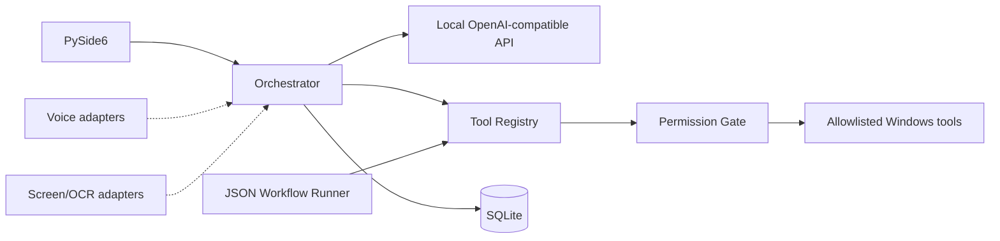

# Hellsaiz PC AI

Локальный desktop-ассистент для Windows. Цель — русский голосовой интерфейс, локальная LLM и безопасное управление приложениями. Код сторонних проектов с несовместимыми лицензиями не копируется.

## Что уже реализовано
- Desktop chat на PySide6.
- OpenAI-compatible adapter для локального сервера моделей (LM Studio, llama.cpp server и совместимые реализации).
- Tool calling через явный реестр инструментов.
- Permission gate: действия с побочным эффектом запрашивают подтверждение.
- Запуск приложений Windows только по alias из allowlist; нет произвольного shell/PowerShell.
- Декларативный JSON workflow runner (до 32 шагов, только зарегистрированные инструменты).
- Локальная SQLite-история.
- Pytest + Ruff и CI на Windows/Linux.

Голосовые устройства, wake word, streaming STT/TTS, vision/OCR, персонаж, OBS и Telegram будут подключаться адаптерами. Они не считаются готовыми, пока не установлены локальные runtime/модели и не пройдены аппаратные тесты.

## Запуск на Windows 10/11
Требуется Python 3.11+.

```powershell
Set-ExecutionPolicy -Scope Process Bypass
.\scripts\setup.ps1
.\scripts\run.ps1
```

По умолчанию ожидается локальный OpenAI-compatible server по адресу `http://127.0.0.1:1234/v1` (стандартный порт LM Studio). В LM Studio нужно загрузить GGUF-модель и включить Local Server. Также можно использовать `llama-server`; в этом случае поменяй `llm.base_url` в `%LOCALAPPDATA%\HellsaizPC_AI\config.toml`. Модель указывается через `llm.model`; конкретный идентификатор зависит от сервера. Для tool calling модель и её chat template должны поддерживать вызовы функций.

Для ручной разработки: `pip install -e ".[dev]"`, затем `pytest` и `ruff check .`.

## Принципы
- Локальный endpoint по умолчанию; удалённые LLM endpoint запрещены настройкой.
- Модель не может запускать произвольные команды и задавать аргументы executable.
- Подтверждение требуется для любого инструмента с побочным эффектом.
- Контент экрана, веба и файлов — недоверенные данные, не инструкции.
- Аудио не записывается в историю. История чата хранится в профиле пользователя.
- Модели и голоса имеют отдельные лицензии от лицензии runtime.

## Архитектура


Voice, vision, avatar and integrations remain optional modules; the core must work without them.
